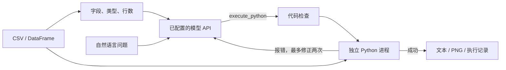

# DataTalk

基于多厂商 Tool Calling 与本地 Python 执行的数据分析后端。输入自然语言问题和 Pandas DataFrame，输出计算结果、图表文件、生成代码及执行记录。

当前范围为后端核心模块：模型接入、Prompt、代码执行和错误修正。Gradio 界面、正式评估数据集和课程展示材料由上层项目集成。

## 功能

- 支持 DeepSeek、OpenAI、通义千问、Moonshot、智谱、硅基流动、OpenRouter、Gemini 以及自定义 OpenAI 兼容接口。
- 使用 `execute_python` 工具调用获取代码，由本地 Pandas / NumPy 完成计算。
- 在独立进程中执行代码，提供超时、常见危险操作静态检查、输出长度限制和 PNG 路径检查。
- 执行失败时把错误作为工具结果返回模型，最多修正 2 次，共最多 3 次生成及执行。
- 每次执行重新载入原始数据，避免失败尝试修改数据后影响后续结果。
- 返回统一结果对象，记录首次执行状态、重试次数、代码、耗时与 Token 用量。
- 每个请求使用独立输出目录，避免多次分析覆盖图表。

## 处理流程



模型负责生成分析代码，本地 Python 负责执行。默认只向 API 发送问题、列名、类型和行数；完整数据在本地执行端使用。可以显式开启少量样本行，以改善日期格式或类别值的理解。

## 环境与安装

Python 3.12，使用 uv 管理虚拟环境与锁定依赖。

```powershell
git clone https://github.com/sdnejsn/DataTalk.git
cd DataTalk
uv sync --locked
Copy-Item .env.example .env
```

在 `.env` 中选择厂商并填写自己的 Key：

```dotenv
API_PROVIDER=
API_KEY=在此填写你的Key
API_BASE_URL=
API_MODEL=
```

预设厂商的 URL 和模型留空时使用项目默认值，也可以通过 `API_BASE_URL` 和 `API_MODEL` 覆盖。模型必须支持 OpenAI Chat Completions 风格的 Tool Calling。DeepSeek 默认使用非思考模式完成工具调用，不展示模型内部推理内容。

`.env`、`.venv`、运行输出、个人数据目录和本地 PDF 已加入 `.gitignore`。真实 Key 不应写入源码或 `.env.example`。

## 命令行

查看 CSV 元数据，无需 Key，也不会调用 API：

```powershell
uv run datatalk inspect --csv examples/sales.csv
```

执行分析，会调用已配置的模型厂商并产生相应费用：

```powershell
uv run datatalk analyze --csv examples/sales.csv --question "计算 sales 总和与 profit 总和。"
uv run datatalk analyze --csv examples/sales.csv --question "按 category 汇总 sales，打印结果并生成柱状图。"
```

非 UTF-8 文件可以指定 `--encoding gb18030`。自定义配置路径使用全局参数，例如：

```powershell
uv run datatalk --env-file .env analyze --csv examples/sales.csv --question "计算平均销售额。"
```

示例 CSV 为 6 行合成数据，仅用于功能检查：`sales` 总和为 3900，`profit` 总和为 900；分类销售额分别为 Electronics 2000、Food 700、Clothing 1200。该数据不代表正式评估集。

命令退出码：`0` 为成功，`1` 为分析失败，`2` 为输入或配置错误。

## Python 接口

供界面集成的入口是 `AnalysisEngine.analyze(question, df)`。完整调用契约、错误处理和 Gradio 示例见 [前端接口说明](前端接口说明.md)。项目对数据分析幻觉的处理机制、适用范围与评估方案见 [幻觉问题处理报告](幻觉问题处理报告.md)：

```python
import pandas as pd
from datatalk import AnalysisEngine, Settings

df = pd.read_csv("examples/sales.csv")

with AnalysisEngine(Settings.from_env(".env")) as engine:
    result = engine.analyze("按 category 汇总 sales 并画柱状图。", df)

if result.success:
    print(result.stdout)
    print(result.artifacts)  # PNG 文件的绝对路径列表
else:
    print(result.error)

payload = result.to_dict()
```

CSV 路径入口：

```python
with AnalysisEngine(Settings.from_env()) as engine:
    result = engine.analyze_csv("计算 sales 总和。", "examples/sales.csv")
```

接口为同步调用。Gradio 事件回调可直接调用；异步 Web 服务应放入工作线程，避免阻塞事件循环。每次调用独立处理问题，不自动继承上一次分析的对话或数据变更。调用方需保证传入的 DataFrame 在请求执行期间不被其他线程修改。

### 结果字段

| 字段 | 含义 |
| --- | --- |
| `success` | 代码是否通过检查、完成执行且产生文本或图表 |
| `stdout` | Python 的实际打印输出及执行期间的警告，最多 32000 字符 |
| `artifacts` | 最终成功尝试的 PNG 绝对路径列表；失败时为空 |
| `code` | 最后一次生成的代码 |
| `error` | 失败原因；成功时为 `None` |
| `attempts` | 每次生成及执行的代码、错误、耗时、Token 用量 |
| `pass_at_1` | 第一次尝试是否执行成功 |
| `retry_count` | 初次尝试之外的尝试次数 |
| `run_id` / `provider` / `model` | 请求标识、厂商与模型名称 |

`success` 和 `pass_at_1` 表示执行状态。语义理解是否正确、计算是否符合题意，需要与参考答案另行核验；不能直接当作准确率。

API 超时、认证、余额、限流或响应协议错误会立即返回失败，不自动重试。输入和配置不符合约束时抛出 `ValueError`；CSV 读取还可能抛出文件或编码相关异常。模型生成代码的执行错误才进入最多两次修正流程。

### 输出目录

```text
outputs/<run_id>/
├── attempt-1/
│   ├── analysis.py
│   └── output.png
├── attempt-2/          # 仅在触发修正时产生
└── result.json
```

失败尝试可能留下中间文件，但不会作为最终成功图表返回。运行记录和图表可能包含原始数据或计算结果，应按数据用途管理；本项目不自动清理历史输出。

## 配置

进程环境变量优先于 `.env`。`.env` 默认从启动命令所在目录读取。

### 厂商预设

| `API_PROVIDER` | 默认 API 地址 | 默认模型 |
| --- | --- | --- |
| `deepseek` | `https://api.deepseek.com` | `deepseek-flash` |
| `openai` | `https://api.openai.com/v1` | `gpt-4.1-mini` |
| `qwen` | `https://dashscope.aliyuncs.com/compatible-mode/v1` | `qwen-plus` |
| `moonshot` | `https://api.moonshot.cn/v1` | `moonshot-v1-8k` |
| `zhipu` | `https://open.bigmodel.cn/api/paas/v4` | `glm-4.5` |
| `siliconflow` | `https://api.siliconflow.cn/v1` | `Qwen/Qwen3-8B` |
| `openrouter` | `https://openrouter.ai/api/v1` | `openai/gpt-4.1-mini` |
| `gemini` | `https://generativelanguage.googleapis.com/v1beta/openai/` | `gemini-2.5-flash` |
| `custom` | 必须设置 `API_BASE_URL` | 必须设置 `API_MODEL` |

厂商可能调整模型名称、下线模型或改变账号权限，表中模型是项目默认值，不代表任一账号当前必然可用。遇到 400 或 404 时，先在厂商控制台确认可用模型，再覆盖 `API_MODEL`。

| 变量 | 默认值 | 含义 |
| --- | --- | --- |
| `API_PROVIDER` | `deepseek` | 厂商预设标识 |
| `API_KEY` | 空 | 必填；仅真实分析时需要 |
| `API_BASE_URL` | 预设值 | 可选覆盖；`custom` 时必填，要求 HTTPS |
| `API_MODEL` | 预设值 | 可选覆盖；`custom` 时必填 |
| `API_TIMEOUT_SECONDS` | `90` | 单次 API 请求超时 |
| `API_MAX_TOKENS` | `4096` | 单次生成的 Token 上限 |
| `DATATALK_MAX_RETRIES` | `2` | 错误修正次数，可选 0 至 2 |
| `DATATALK_EXECUTION_TIMEOUT_SECONDS` | `30` | 单次子进程执行超时，含启动时间 |
| `DATATALK_OUTPUT_DIR` | `outputs` | 输出根目录 |
| `DATATALK_SAMPLE_ROWS` | `0` | 发给模型的样本行数，可选 0 至 10 |
| `DATATALK_MAX_CSV_MB` | `20` | CSV 文件大小限制，单位 MiB |
| `DATATALK_MAX_ROWS` | `100000` | 行数上限 |

另有 200 列上限、元数据 40000 字符上限、问题 8000 字符上限、代码 30000 字符上限和单次最多 5 张 PNG 的限制。DataFrame 深度内存用量上限为 CSV 大小配置的 10 倍。绘图会优先选择本机已安装的微软雅黑、黑体或 Noto CJK 字体；没有中文字体时可能出现缺字警告。

## 测试与验证范围

```powershell
uv run pytest -q
uv run ruff check .
```

自动化测试使用预设模型返回内容或模拟 API 响应，不需要 Key、不会产生 API 费用。真实子进程测试覆盖数值计算、PNG 生成、错误反馈、重试上限、数据恢复、请求目录隔离、执行超时及部分受限操作；适配器测试检查工具调用参数和异常响应处理。

这些测试验证本地后端行为与请求构造，不证明线上模型服务已连通，也不构成项目准确率评估。填写 Key 后需另行运行真实 API 示例，再使用独立参考答案评估正式问题集。

## 执行边界

本版本用于本地、可信数据的课程原型。独立进程、受限 builtins 和 AST 检查提供基础约束，不能等同于操作系统级安全沙箱，仍存在 Python / 数值库能力绕过和内存耗尽的风险。当前不适合直接开放为接收任意用户代码或不可信数据的公共服务；公共部署需要容器或操作系统权限隔离、资源配额和网络隔离。

代码执行进程不接收 API Key；默认元数据模式仍会把问题、列名和类型发送到所选模型厂商，错误修正时还会发送执行错误信息。开启样本行后对应单元格内容也会被发送。CSV 内容不应包含不允许发送到外部模型服务的信息。

## 代码结构

```text
src/datatalk/
├── config.py       # 环境配置与参数校验
├── dataset.py      # CSV 读取、DataFrame 校验、元数据
├── prompts.py      # 系统提示词与工具定义
├── providers.py    # 厂商预设与前端目录
├── llm.py          # OpenAI 兼容 API 适配
├── policy.py       # 基础代码约束
├── _worker.py      # 单次 Python 执行进程
├── executor.py     # 子进程管理与图表路径校验
├── engine.py       # 分析与错误修正流程
├── models.py       # 结果与尝试记录
└── cli.py          # 命令行入口
examples/           # 合成数据与接口调用示例
tests/              # 无真实 API 调用的自动化测试
```

## API 参考

- [DeepSeek API 首次调用](https://api-docs.deepseek.com/)
- [Tool Calls](https://api-docs.deepseek.com/guides/tool_calls/)
- [Thinking Mode](https://api-docs.deepseek.com/guides/thinking_mode/)
- [OpenAI API](https://platform.openai.com/docs/api-reference/chat)
- [阿里云百炼 OpenAI 兼容接口](https://help.aliyun.com/zh/model-studio/compatibility-of-openai-with-dashscope)
- [Gemini OpenAI compatibility](https://ai.google.dev/gemini-api/docs/openai)
